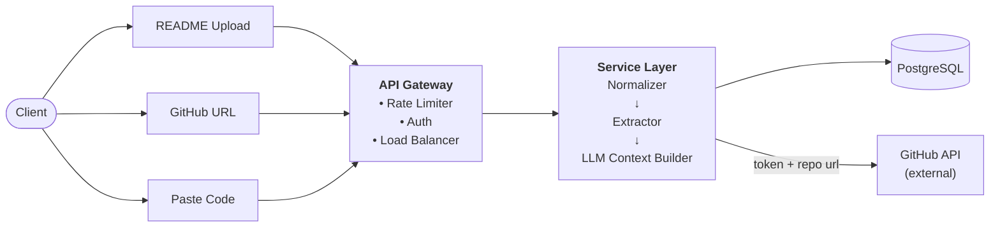
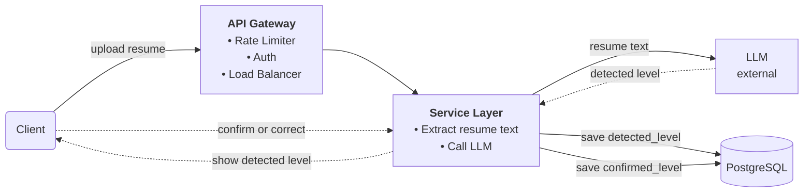
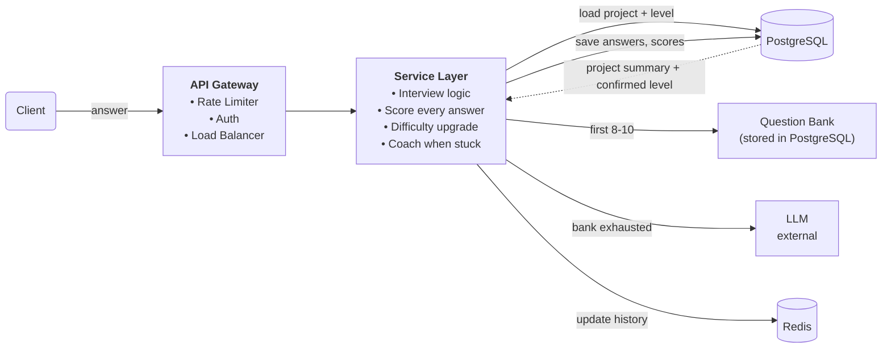
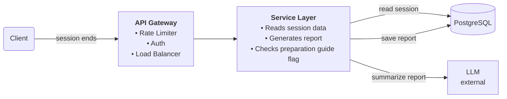

# GrillMyProject

## 1. Project Name and Problem Statement

**Project name:** GrillMyProject

**Problem:** Developers preparing for interviews have no platform to practice on their own personal projects. Every existing platform offers generic questions, peer interviews, or DSA practice. Nobody grills you on the project you actually built and will be asked about in a real interview.

---

## 2. Core Functional Requirements

1. **Project input.** User can add their project in three ways:
   - Upload a README
   - Connect a private GitHub repo using a personal token
   - Paste the codebase directly
2. **Resume scan.** System scans the resume and detects the experience level (Easy / Medium / Hard). User confirms it.
3. **Live interview.** AI runs a live session of 25 questions in 45 minutes, with dynamic questioning, follow-ups, and real-time scoring.
4. **Session report.** Generated at the end of the session:
   - Overall score
   - Score per question
   - Weak and strong areas
   - Feedback on answer structure

---

## 3. Additional Functional Requirements

Also part of Phase 1, kept separate so the core stays clear.

- **Three layer questioning**
  - Generic opening questions from a curated bank
  - Technology specific questions from a curated bank
  - LLM deep dive questions for the rest
- **Timer per question**
- **Three prompt personalities** based on level: Easy, Medium, Hard
- **Dynamic difficulty escalation.** If the user scores 7+/10 consistently, AI moves to the next difficulty level for the final questions.
- **Coaching when stuck.** AI motivates and guides the user, and never lets them feel defeated.
- **5 lens preparation guide.** Shown in the report only when AI detects unstructured or shallow answers.
- **Session history.** User can revisit all past interview sessions.

---

## 4. Core Non Functional Requirements

1. **Low latency.** LLM response must return fast enough to feel like a real conversation.
2. **Consistency over availability.** Every answer and score is saved to the database before the next question is served. No data loss during live sessions.
3. **Security.** GitHub personal tokens are encrypted before storing. User data is protected.
4. **Fault tolerance.** If the user drops off mid session, all progress is saved and the session can be recovered.

---

## 5. Additional Non Functional Requirements

Also handled in Phase 1.

- **Scalability.** System handles concurrent interview sessions without the database becoming a bottleneck. Active session data is cached in Redis, permanent data lives in PostgreSQL.
- **LLM rate limit handling.** A Redis queue absorbs excess LLM requests at scale. No request fails, they wait in the queue.
- **Rate limiting per user.** Maximum 10 LLM calls per minute per user, to prevent abuse and control API cost.

---

## 6. Core Entities

The main objects the system stores and works with.

**User**
- id, name, email, google_oauth_id, created_at

**Resume**
- id, user_id, raw_text, detected_level (easy/medium/hard), confirmed_level, created_at

**Project**
- id, user_id, input_type (readme/github/paste), raw_content, extracted_summary, detected_technologies, github_token (encrypted), created_at

**Session**
- id, user_id, project_id, difficulty_level, status (ongoing/completed), started_at, ended_at

**Message**
- id, session_id, role (ai/user), content, question_number, question_id (null for LLM questions), score (out of 10), feedback, created_at

**Report**
- id, session_id, overall_score, strong_areas, weak_areas, answer_structure_feedback, show_preparation_guide (boolean), created_at

**Question**
- id, text, type (generic/technology), technology (null for generic), difficulty_level (easy/medium/hard), created_at

---

## 7. API Design

### GET /api/auth/google
Start Google login. Redirects the user to Google.

### GET /api/auth/google/callback
Google redirects back here with a code. We create the user if new and start a login session (cookie).

Response:
```json
{ "user": { "id": "string", "name": "string", "email": "string" } }
```

### GET /api/auth/me
Get the logged in user.

Response:
```json
{ "id": "string", "name": "string", "email": "string" }
```

### POST /api/auth/logout
End the login session.

Response:
```json
{ "success": true }
```

### POST /api/resume/upload
Upload resume, scan it, return detected level.

Request:
```json
{ "file": "pdf" }
```
Response:
```json
{ "detected_level": "easy/medium/hard", "resume_id": "string" }
```

### POST /api/project
Submit project input.

Request:
```json
{
  "input_type": "readme/github/paste",
  "content": "string",
  "github_token": "string (optional)"
}
```
Response:
```json
{ "project_id": "string", "extracted_summary": "string" }
```

### POST /api/session/confirm-level
User confirms or changes the detected level.

Request:
```json
{ "resume_id": "string", "confirmed_level": "easy/medium/hard" }
```
Response:
```json
{ "confirmed": true, "level": "string" }
```

### POST /api/session/start
Start the interview session and get the first question.

Request:
```json
{ "project_id": "string", "level": "easy/medium/hard" }
```
Response:
```json
{
  "session_id": "string",
  "question": "string",
  "question_number": 1,
  "timer_seconds": 108
}
```

### POST /api/session/answer
Submit an answer. Scoring happens async, so this returns right away. The result comes through the stream below.

Request:
```json
{ "session_id": "string", "question_number": 1, "answer": "string" }
```
Response:
```json
{ "status": "processing", "question_number": 1 }
```

### GET /api/session/{session_id}/stream
Open a server-sent events (SSE) stream. After each answer, it pushes the score, feedback and next question when the LLM is done.

Event data:
```json
{
  "score": 7,
  "feedback": "string",
  "next_question": "string",
  "question_number": 2,
  "session_complete": false
}
```

### POST /api/session/{session_id}/end
Mark the session complete and trigger report generation.

Request:
```json
{ "session_id": "string" }
```
Response:
```json
{ "session_id": "string", "report_id": "string" }
```

### GET /api/session/{session_id}/report
Get the final session report.

Response:
```json
{
  "overall_score": 7,
  "per_question_scores": [],
  "strong_areas": "string",
  "weak_areas": "string",
  "answer_structure_feedback": "string",
  "show_preparation_guide": false
}
```

### GET /api/sessions
Get all past sessions for the logged in user.

Response:
```json
{
  "sessions": [
    {
      "session_id": "string",
      "date": "string",
      "overall_score": 7,
      "level": "string",
      "status": "string"
    }
  ]
}
```

---

## 8. High Level Design

### 1. Project Input and Extraction

**Problem**

We need enough project context to run a deep technical interview. How do we get meaningful content out of whatever the user submits?

**Approach 1: Manual form**

User fills a form and types project details by hand.

Problem: the user controls what they share, so the input is biased and incomplete. The LLM only knows what the user wanted to tell it. It cannot ask deep, implementation specific questions.

**Approach 2: Send the full codebase**

User submits all their code and we send everything to the LLM.

Solves: the LLM sees the real implementation, not the user's filtered version.

New problem: too expensive and too many tokens. The LLM loses focus in 10,000 lines of code, and interview quality actually drops.

**Approach 3: Selective extraction (final)**

Three input options: README upload, GitHub private repo via personal token, or pasted code. From whatever the user gives us, we extract only:

- README: project overview and tech stack
- File tree: architecture at a glance
- Function signatures: core logic without implementation noise

Solves Approach 1: the LLM sees the real project, not the user's filtered version.

Solves Approach 2: context stays focused and cheap, and the LLM stays sharp and asks specific questions.

**Diagram**



For GitHub input, repo files are fetched before normalization. For README upload and pasted code, content goes directly to the Normalizer.

### 2. Resume Scan and Level Detection

**Problem**

When a user comes to the platform, we don't know their experience level. Without knowing the level, we cannot calibrate the interview difficulty correctly.

**Approach 1: Manual selection**

User selects their own level: Easy, Medium, or Hard.

Problem: users lie to themselves. A beginner picks Hard to feel good. The interview is calibrated wrong and the experience breaks down.

**Approach 2: LLM scans resume and decides**

LLM reads the resume and automatically detects the level.

Solves Approach 1: user cannot lie, the system decides.

New problem: the LLM can be wrong. If it misreads experience, the user gets the wrong level with no way to fix it.

**Approach 3: LLM scans resume, user confirms (final)**

LLM reads the resume and returns a detected level. The user sees the result and confirms or corrects it before the interview starts.

Solves Approach 1: no manual bias.

Solves Approach 2: the user validates what the LLM detected. Human confirmation acts as a safety net.

**Diagram**



detected_level is what LLM found. confirmed_level is what the user validated. If the user corrects the level, confirmed_level is updated. detected_level stays unchanged so we can track LLM accuracy over time.

### 3. Live Interview Session

**Problem**

Once the interview starts, the system needs to ask the right questions at the right difficulty, score answers in real time, and adjust difficulty based on how the user is performing, all in one seamless session.

**Approach 1: Fixed question list**

We prepare a list of questions beforehand. Every user gets the same questions in the same order. No matter how well or badly they answer, the next question does not change.

Problem: a user who answers everything perfectly gets the same easy questions as someone struggling. Strong users get bored. Weak users never get help. It feels nothing like a real interview.

**Approach 2: LLM generates every question**

LLM reads the project and creates every question fresh based on the previous answer. No pre-written questions at all.

Solves Approach 1: questions are now specific to the user and their answers.

New problem: the LLM has no structure or difficulty control. Sometimes it asks too hard, sometimes too easy, with no consistency. Every single question costs an API call, which is expensive with no savings.

**Approach 3: Question bank + LLM + automatic difficulty upgrade (final)**

The first 8-10 questions come from the question bank: generic openers and technology specific questions. The LLM takes over after that for deep project specific questions. Score is tracked after every answer. If the user is consistently scoring well, difficulty automatically upgrades to the next level.

Solves Approach 1: difficulty adapts based on how the user performs.

Solves Approach 2: the question bank saves cost. The LLM is only used where it adds real value. Difficulty is controlled and structured.

**Diagram**



Question bank handles first 8-10 questions without calling LLM. Every answer is scored immediately after it is given. Difficulty upgrades automatically when score is consistently 7+ out of 10. Session ends after 25 questions or 45 minutes.

### 4. Report Generation

**Problem**

When the interview ends, the user needs to understand where they did well and where they failed, not just a single number, but enough detail to know what to work on next.

**Approach 1: Single overall score**

At the end of the interview show one number. Example: 7 out of 10.

Problem: the user knows they scored 7 but has no idea where they did well or where they failed. No direction on what to improve.

**Approach 2: Score per topic**

Show score per technology or topic. Redis: 7/10. Database: 2/10. JWT: 8/10.

Solves Approach 1: the user now knows which areas are weak.

New problem: still just numbers. No explanation of why they scored low and no guidance on what to do next. The user knows they are bad at database but does not know how to fix it.

**Approach 3: Real time scoring + detailed report + preparation guide (final)**

Every answer is scored and saved during the interview with a one line explanation of what was wrong. When the session ends, the Service Layer reads all saved scores and calls the LLM to summarize them into a full report: overall score, per question score, weak areas, strong areas, and honest feedback on answer quality. If answers were unstructured, a preparation guide is shown automatically.

Solves Approach 1: full breakdown, not just one number.

Solves Approach 2: not just scores but an explanation of what was wrong and how to improve.

**Diagram**



Preparation guide is shown automatically when LLM detects answers were unstructured or shallow.

---

## 9. Component Breakdown

Components used across the HLD diagrams.

- **Client:** the web app the user uses. Built with Next.js.
- **API Gateway:** single entry point for all requests. Handles rate limiting, authentication, and load balancing before anything reaches the services.
- **Rate Limiter:** stops a user from sending too many requests in a short time. Prevents abuse and controls API cost.
- **Authentication:** checks the user is logged in via Google OAuth before letting the request through.
- **Routing / Load Balancer:** spreads traffic evenly across service instances so no single server gets overloaded.
- **Service Layer:** the FastAPI backend. Contains all business logic including interview management, scoring, report generation, and project extraction.
- **Normalizer:** converts all three project input types (README, GitHub URL, pasted code) into one standard format before extraction.
- **Extractor:** pulls only the README, file tree, and function signatures from the normalized content. Discards everything else.
- **LLM Context Builder:** packages extracted content into a structured prompt context ready for the interview session.
- **GitHub API:** external service called only when the user inputs a GitHub URL. Fetches repo files using the personal token.
- **LLM:** external AI service used for resume level detection, generating deep dive questions, scoring answers per question, coaching when stuck, and summarizing the final report.
- **Redis:** stores active session conversation history in memory during a live interview. Much faster than PostgreSQL for frequent reads. Cleared when the session ends.
- **Question Bank:** stores generic opening questions and technology specific questions. Used for the first 8-10 questions to save LLM API cost.
- **PostgreSQL:** main database. Stores users, resumes, projects, sessions, messages, and reports permanently.
